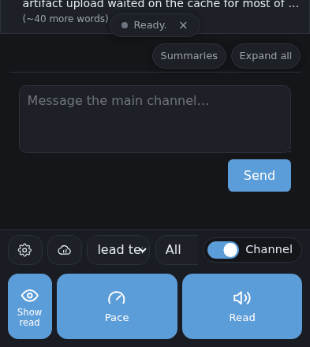
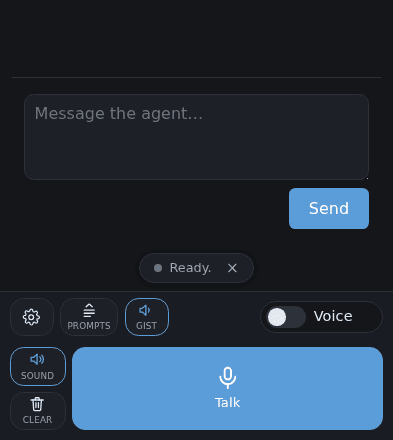
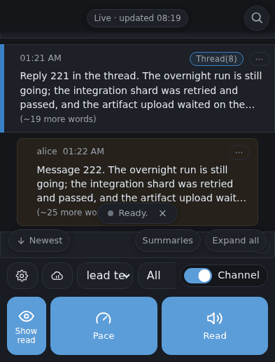
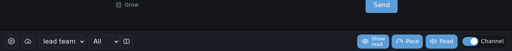

# channel-bars-layout: rethinking the channel view's two bottom bars (proposal)

> **Update 2026-10-23 (`#455 vibe-talk-next-plan`).** Part of the master plan,
> [`2026-10-23-vibe-talk-next/README.md`](2026-10-23-vibe-talk-next/README.md). Terms follow its
> [terminology](2026-10-23-vibe-talk-next/TERMINOLOGY.md). This proposal is on its UI track,
> independent of the data model; its questions are group I of the consolidated list. Nothing here is
> superseded.

> **Update 2026-10-27 (`#573 scrubber-full-width`).** A playback policy that whichever option is
> picked must keep: see [Playback policy](#playback-policy-2026-10-27-573-scrubber-full-width) below.

[opus 5.5] A proposal for the owner. Nothing here is implemented. Written on 2026-10-22, after
`#429 keyboard-hides-bar`, and with the `mu-readstrip` lane in mind (it moves the floating read-aloud
strip down onto the bottom controls row, with no gap, and gives it Play/Pause).

## What the owner asked

> More generally, I would like to rethink the usage of that lower bar in the channel view. I don't
> really want to accidentally hit read and have my phone start making sound, so I'd really rather have
> a read controller interface that is collapsed by default and that I need to explicitly expand. But
> right now our space usage is weird. We have completely filled up one row of our interface with the
> settings gear, the channel selector, the thread selector and the toggle between channel and voice
> mode. But then our big second row has a way bigger than needed Pace button but it also includes the
> show hide collapse toggle for read messages which is unrelated to voice reading. [...] I don't really
> want to keep shrinking the channel selector or thread selector to the point that they become useless.

Every option below has to meet five constraints:

1. Read-aloud is collapsed by default behind one small, deliberate control, so nothing makes sound by
   accident.
2. The read-mode toggle (Show / Fold / Hide read) leaves the voice bar and goes where the list's
   reading-state controls are.
3. Pace shrinks to a sensible size, or lives inside the expanded read-aloud panel.
4. The channel and thread selectors keep a usable width.
5. It works with `#429 keyboard-hides-bar`, which hides both rows while the on-screen keyboard is up.

## Today

Screenshots of the page as it is (Chromium, fake channel of 24 messages, dark scheme). The phone
captures are cropped to the bottom 440px.

| Phone 393x852, channel view | Phone, call view | Phone, keyboard up (before #429) |
|---|---|---|
|  |  |  |

Desktop 1280x800, channel view (bottom 130px):



What the layout measures. These are the page's bounding boxes as Chromium reports them, from
`getBoundingClientRect` in the captures above:

| | Phone 393x852 | Desktop 1280x800 |
|---|---|---|
| Dock (both rows) | 149px tall | 50px tall (one row) |
| Top row (`#control-bar`) | 46px | in the dock's one row |
| Big tile (`#control-pane`) | 102px | 251px wide, in the same row |
| Message list (`#scroll-area`) | 659px of 852 | 707px of 800 |
| Channel picker | **80px** wide ("lead te…") | 119px |
| View picker | **80px** wide, its last 20px under the Voice/Channel switch | 80px |
| With the keyboard up (336px) and no #429 | list 323px, the box and Send below the keys | — |

Two things in those numbers matter beyond what the owner already said. The top row is overfull: the
pack that holds the pickers scrolls sideways, so on the phone the view picker's arrow sits under the
switch. And the dock is 149px of an 852px screen, 102px of it the big tile.

### Inventory

How often each control gets used is my estimate from what it does. The page has no usage counts.

**Top row** (`#control-bar`; in the dock by default, or in the header if Settings moves it there)

| Control | Phone | Desktop | What it does | Likely use | Serves listening? |
|---|---|---|---|---|---|
| Settings gear | 44px | 36px | Opens Settings | Rare: a few times a week | no |
| Audio source (phone or cloud icon) | 44px, channel view only | 36px | Whether read-aloud speaks with device speech or the configured voice agent | Rare: set once | **yes, only** |
| Channel picker | 80px | 119px | Which channel the view reads | Often: several times a session | no |
| View picker | 80px | 80px | Main, All, Threads (and Two columns on a desk), then each thread | Often | no |
| Two columns | not drawn | 32px, desk ≥1000px | Main and a thread side by side | Occasional, on a desk | no |
| Prompts | call view only | call view only | Canned questions for the agent | Occasional, in a call | no |
| Gist / Full / Off | call view only | call view only | What happens to an arriving channel message during a call | Rare | yes (during a call) |
| Voice/Channel switch | 126px | 120px | Flips between the call and the channel | Often | no |

**Big tile** (`#control-pane`), channel view with no call

| Control | Phone | Desktop | What it does | Likely use | Serves listening? |
|---|---|---|---|---|---|
| Show / Collapse / Hide read | 56x83px | 80x36px | Cycles how the list shows messages already read | Occasional: set per session | **no**: it is a list filter |
| Pace | 153x83px | 78x36px | Opens a popover with a 50–200% slider | Rare | yes |
| Read / Stop | 153x83px | 80x36px | Turns **reading mode** on or off | Occasional | yes |

Reading mode is the hazard. Read plays nothing by itself. It arms the list, so that the next tap on any
message reads that message aloud and archives it when it finishes. An accidental tap on Read therefore
turns an ordinary later tap, meant to open or select a message, into sound. The Read tile is the
biggest target on the screen and sits right where the thumb rests.

In the **call view** the tile holds Sound, Clear, Hang up and Talk. Those are out of scope here, apart
from noting that the same "one big tile" question applies to Talk.

## Moves every option shares

The three options differ only in where the pickers go. These four moves are the same in all of them:

1. **Show / Fold / Hide read becomes a chip** in the row of chips that already float over the foot of
   the list, beside Summaries and Expand all. Those chips change how the list is drawn, and this
   control is the same kind of thing. It keeps its one-tap cycle and its icon, and it costs no row,
   because that chip row is already there. On a desk it sits in the same chip row.
2. **Read-aloud folds behind one small toggle**, `🔊 Read ˄`, a normal bar button about 44–87px wide.
   Tapping it only opens or closes the **read panel**. It never plays anything and never arms the list.
   The panel is one slim row (about 62px on the phone) directly above the bottom row:
   `[audio source] [ − Pace 100% + ] [ Read ]`. Read in the panel arms reading mode, as Read does today.
   So starting to listen takes two deliberate taps, toggle then Read, and neither of them is the biggest
   thing on the screen.
3. **Pace becomes a stepper inside the panel** (`−  Pace 100%  +`, 5% a step; a long press could open
   today's slider). That is a third of today's tile, and it is out of sight until the panel is open.
4. **Audio source moves from the top row into the panel.** It only matters for read-aloud, and taking
   it out gives the pickers 44px on the phone.

**The read strip (mu-readstrip).** That lane puts the "reading mode: tap a message…" strip directly on
the bottom controls row and gives it Play/Pause. In these layouts the strip sits on whatever the dock's
top edge is: on the open panel, or on the bottom row when the panel is closed and a reading is still
going. Its Play/Pause and close are then the way to control listening while the panel is folded away.
While reading mode is on, the `🔊 Read ˄` toggle should look active (lit, "Reading"), so a reader who
folded the panel can see that a tap on a message will still make sound.

**With the keyboard up (#429).** Both rows and the panel go, as they do since #429. While reading,
#429 keeps one slim Stop row. Once the read strip exists, its Play/Pause and close could serve as that
slim control instead, so one strip stays rather than two (question 6).

## Option A: one strip

Everything on one bottom row. The switch loses its word and keeps its knob.

```
Phone, at rest (dock 51px; list 758px, +99 on today)
┌──────────────────────────────────────────────────────┐
│ …list…                                               │
│            [◉ Show read] [Summaries] [Expand all]    │  ← chips over the list foot
│ ┌──────────────────────────────────────────────────┐ │
│ │ Message the main channel…                        │ │
│ └──────────────────────────────────────────────────┘ │
│                                           [ Send ]   │
├──────────────────────────────────────────────────────┤
│ [⚙] [ lead team      ▾] [ All    ▾] [🔊˄] [◐━]       │  ← one row, 46px
└──────────────────────────────────────────────────────┘
   channel picker 114px, view picker 82px

Panel open (+62px)
├──────────────────────────────────────────────────────┤
│ [⚙] [ lead team      ▾] [ All    ▾] [🔊˅] [◐━]       │
│ [☁] [  −   Pace 100%   +  ] [   🔊 Read    ]          │
└──────────────────────────────────────────────────────┘
```

- Gains the most room: 99px back for the list at rest.
- The pickers grow from 80/80px to about 114/82px. That is better than today, but not a lot: a channel
  name of about 10 characters still truncates.
- The switch without its word is a bare knob. It is less obvious, though its state still shows.

## Option B: two slim rows, the pickers on a row of their own (recommended)

The pickers get the full width. The gear, the read toggle and the switch share the row under them.

```
Phone, at rest (dock 95px; list 714px, +55 on today)
├──────────────────────────────────────────────────────┤
│ [ lead team                    ▾] [ All          ▾]  │  ← pickers, 236px and 131px
│ [⚙] [🔊 Read ˄]                      [◐━ Channel]    │  ← gear, read toggle, switch
└──────────────────────────────────────────────────────┘

Panel open (+62px)
├──────────────────────────────────────────────────────┤
│ [ lead team                    ▾] [ All          ▾]  │
│ [⚙] [🔊 Read ˅]                      [◐━ Channel]    │
│ [☁] [  −   Pace 100%   +  ] [   🔊 Read    ]          │
└──────────────────────────────────────────────────────┘

Keyboard up (#429): nothing but the list and the box; a reading in progress keeps one slim Stop
(or the read strip's Play/Pause, question 6).
```

- The pickers are about three times today's width (236/131px against 80/80px), so channel and thread
  names read whole.
- Everything stays at the thumb, and the switch keeps its word.
- The list still gains 55px at rest, and the big blue tile is gone.
- The second row has spare room, deliberately: the next control the bar needs goes there without
  pricing anything else off a 375px strip.

## Option C: the pickers become the screen's title row

The channel and view pickers move to a slim row at the top, like a chat app's channel title. The bottom
keeps one row: gear, read toggle, switch.

```
Phone, at rest (top row 50px + dock 51px; list 707px, +48 on today)
┌──────────────────────────────────────────────────────┐
│ [ lead team                  ▾] [ All           ▾]   │  ← pickers, 222px and 145px
│                (Live · updated 08:18)         (🔍)   │
│ …list…                                               │
│            [◉ Show read] [Summaries] [Expand all]    │
│ …box, Send…                                          │
├──────────────────────────────────────────────────────┤
│ [⚙] [🔊 Read ˄]                      [◐━ Channel]    │
└──────────────────────────────────────────────────────┘
Panel open: one slim row above the bottom row, as in A and B.
Keyboard up: #429 has to hide the title row as well (one more selector).
```

- The pickers are wide, and the channel's name reads as the screen's title.
- They are no longer at the thumb: switching channel means a reach to the top of a tall phone.
- It gains the least room (48px), because the title row costs a strip at the top.
- The page already has a "bar at the top" setting. C is close to that setting with only the pickers
  moved up, so this is a second top-row arrangement to keep working, not a new one.

## Desktop (every option)

A desk already has one 50px row, and it has the width. The shared moves apply, and the row keeps its
shape:

```
1280x800, panel closed
[⚙] [lead team ▾] [All ▾] [⫼] [🔊 Read ˄]  ·························  [◐━ Channel]
1280x800, panel open (it opens in the same row, to the left of the switch)
[⚙] [lead team ▾] [All ▾] [⫼] [🔊 Read ˅]  ······  [☁] [− Pace 100% +] [🔊 Read]  [◐━ Channel]
Show / Fold / Hide read: a chip beside Summaries and Expand all, over the foot of the list.
```

The desk's list height does not change (707px). What changes is that nothing on it can start reading
mode in one click.

## How the numbers were measured

The list heights and picker widths for A, B and C come from a scratch session. I loaded the page in
Chromium at 393x852 (touch) and 1280x800, added each option's CSS, moved the nodes in the page with a
script, and read `getBoundingClientRect`. None of it touched the repository's page. They are close
estimates, not a spec. The real change will set its own widths, and the page suite's "the bar fits on
the owner's 375px phone" pricing will need its member list updated.

## Recommendation

**Option B**, together with the four shared moves. It is the only option where both pickers become
genuinely usable (236/131px) without giving up thumb reach or the switch's label. It still returns 55px
to the list. It removes the big Read target, so listening takes two deliberate taps.

If every pixel matters more than the pickers' width, A is the fallback: it gives the most room, and
its pickers are still wider than today's. C's main draw is the title-like channel name, and on a tall
phone that costs too much reach.

Rough cost of B: changes to `web/voice.html` (a toggle and the panel's stepper; the read filter moves to
`#scroll-tools`), `web/voice.css` (the strip's two-row grid; the panel), and `web/voice.js` (the toggle,
the panel state, the stepper writing the existing pace key). Then the page suite's bar-pricing and
"READ OWNS THE THUMB" assertions get rewritten, and a phone and desk browser walk is added. The read
strip's positioning comes from mu-readstrip, which should land first so the panel can sit under it
rather than fight it.

## Playback policy (2026-10-27, `#573 scrubber-full-width`)

[opus 5.5] Added after this proposal was written, at the owner's request (2026-10-27): whatever layout
the redesign picks keeps this policy. `#573 scrubber-full-width` implements it for today's two rows.

**The policy.** On a phone, while a read of several blocks is up:

- **The read strip (the scrubber) is a full-width row**, edge to edge within the safe-area insets,
  standing flush on the dock's **transport row**: the row that holds the read's Pause/Resume and Stop.
  It does not float, and the list ends at its top edge, so no message scrolls under it.
- **While the read plays, everything secondary hides**: the bar's other rows (the gear, the pickers,
  the Voice/Channel switch, the read toggle) and the floating chips. The list takes their room.
- **Paused, the chips come back** (they float and move nothing) and the secondary rows stay hidden, so
  a pause or a resume never resizes the list or moves the strip under the thumb. This matches
  [car-mode-design](2026-10-26-car-mode/README.md): pause keeps the reading layout, stop closes it.
- **Stop, or the end of the read, brings everything back.**
- The keyboard-up slim row (`#429`) still applies, and the strip stands on it. A desk is unaffected.

The page states it on the root as `data-read-strip="playing"` or `"paused"` (absent with no strip;
`renderReadLayout` in `web/voice.js`). The redesign should key its own hiding off that attribute
rather than add a second state. The multi-track scrubber (the hierarchical navigator in
[documents-view](2026-10-26-documents-view/README.md)) grows the strip upward from the same place.

**How it maps onto each option.**

- **Option B (two slim rows and the read panel).** The transport row is the read panel's row, with Read
  as Pause and Stop beside it. While a read plays, the pickers row and the gear/toggle row hide, and the
  panel's row stays, with the strip on it. If the reader had folded the panel away, it shows again for
  the read, because the policy needs Pause and Stop on screen. The other rows come back at stop.
- **Option A (one row).** There is no second row to hide, so the biggest saving goes away. The owner
  suspected the policy might then not matter. Two parts of it still do:
  - **The chips still hide while playing.** They are what floats over the foot of the list, so this
    is still room for the list.
  - **The single row has to become the transport row while a read plays.** At rest it holds the gear,
    the pickers, the read toggle and the switch, but no Pause or Stop. So for the length of the read it
    swaps its members for the transport (Pace, Stop, Pause), and the strip stands on it. That is a swap
    of the row's contents, not a new row, so it costs no height. At stop the row goes back to the gear
    and the pickers.

  The alternative, opening the panel as a second row under the strip, would bring back the stacked
  rows this policy removes.
- **Option C (the pickers in the title row).** The title row is secondary: hide it while playing, as
  `#573` does for a bar moved to the top. The bottom rows map as in A or B.

## Questions for the owner

1. **A, B or C?** (I recommend B.)
2. **The read filter as a chip** beside Summaries and Expand all: is that the right home? The other
   candidate is the view picker's menu ("Main · hide read"), but a `<select>` cannot cycle in one tap.
3. **Should the read panel remember being open?** I suggest it starts closed on every load, so a fresh
   page can never be one tap from sound.
4. **Two taps to listen** (the toggle, then Read): is that deliberate enough, or should arming reading
   mode also need a confirmation the first time in a session?
5. **Audio source in the panel**: fine there, or should it go to Settings only?
6. **Keyboard up while reading**: keep #429's slim Stop row, or let the read strip's Play/Pause be the
   one control left on screen once mu-readstrip lands?
7. **Fold the panel when a reading stops?** I suggest not, since a reader who opened it is likely to
   read the next message as well.
8. **The call view's Talk tile** has the same "giant button" shape. Bring it into this rework too, or
   leave it alone?
